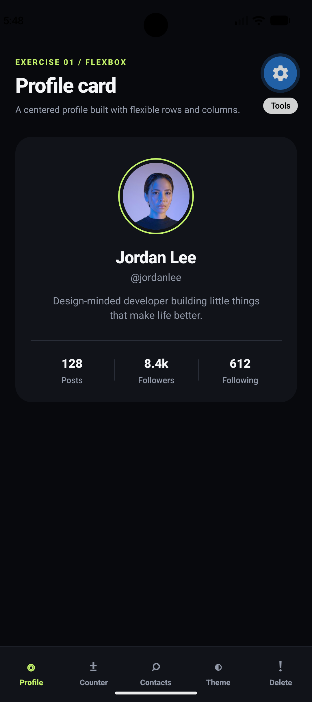
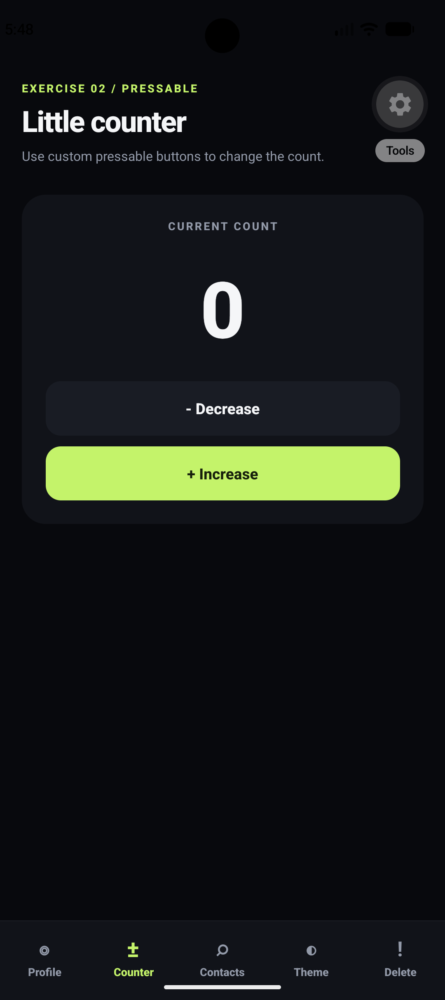
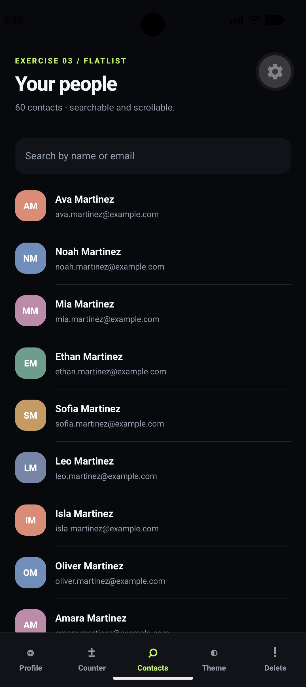
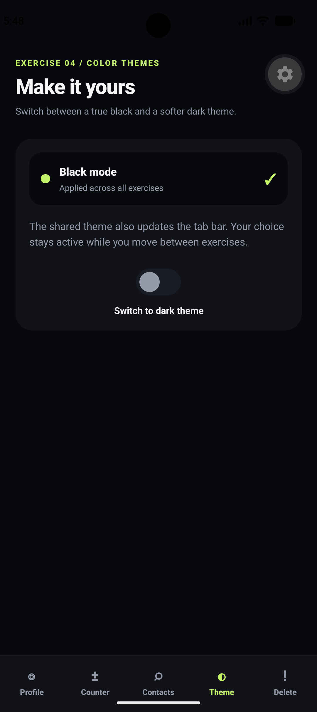
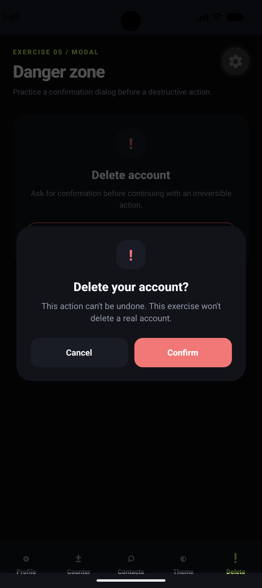

# Revision React Native

A practical React Native exercise app built with Expo and Expo Router. The app demonstrates core mobile UI patterns, reusable components, tab navigation, local state, searchable lists, themes, and confirmation dialogs.

## Tech Stack

- Expo SDK 58
- React Native 0.88
- React 19
- Expo Router with typed routes
- TypeScript with strict mode
- React Native Safe Area Context
- ESLint with Expo configuration

## App Features

| Exercise | Implementation |
| --- | --- |
| Profile card | Flexbox layout, profile image, biography, and statistics |
| Counter | Local state and accessible custom pressable buttons |
| Contacts | Generated mock data, `FlatList`, search, separators, and empty state |
| Theme switcher | Shared theme context for black and dark palettes |
| Delete confirmation | React Native modal with cancel and confirm actions |

## App Preview

| Profile | Counter |
| --- | --- |
|  |  |

| Contacts | Theme |
| --- | --- |
|  |  |

| Delete confirmation |
| --- |
|  |

## Getting Started

### Requirements

- Node.js
- npm
- An Android emulator, iOS simulator, Expo Go, or a physical device

### Install

```powershell
npm install
```

### Run

```powershell
npx expo start
```

Use one of the following commands to open a target directly:

```powershell
npm run android
npm run ios
npm run web
```

## Project Structure

```text
src/
  app/
    _layout.tsx              # Root stack layout
    (tabs)/
      _layout.tsx            # Bottom tab navigation and theme provider
      index.tsx              # Profile card exercise
      counter.tsx            # Counter exercise
      contacts.tsx           # Searchable FlatList exercise
      theme.tsx              # Theme switcher exercise
      delete.tsx             # Modal confirmation exercise
  components/
    exercise-header.tsx      # Shared exercise heading
    profile-stat.tsx         # Profile statistic
    theme-context.tsx        # Shared theme state and palettes
app-preview/                 # Application screenshots
app.json                     # Expo application configuration
tsconfig.json                # Strict TypeScript and path configuration
```

## Navigation and State

- Expo Router defines screens from files inside `src/app`.
- The `(tabs)` route group provides the bottom tab navigator.
- The `ThemeProvider` wraps the tab navigator so every exercise shares the selected palette.
- Theme state currently remains active only for the current app session.
- Screen-level state is managed with React `useState`.
- Contact filtering is memoized with `useMemo`.

## Development Commands

```powershell
npx expo start        # Start the Expo development server
npx expo lint         # Run ESLint
npx tsc --noEmit      # Run the TypeScript compiler
npm run android       # Open on Android
npm run ios           # Open on iOS
npm run web           # Open in a browser
```

Before submitting changes, run:

```powershell
npx expo lint
npx tsc --noEmit
```

> The repository also contains a starter `example/` project. If it is not required, exclude it from the root TypeScript and routing configuration or remove it to avoid unrelated type-check errors.
